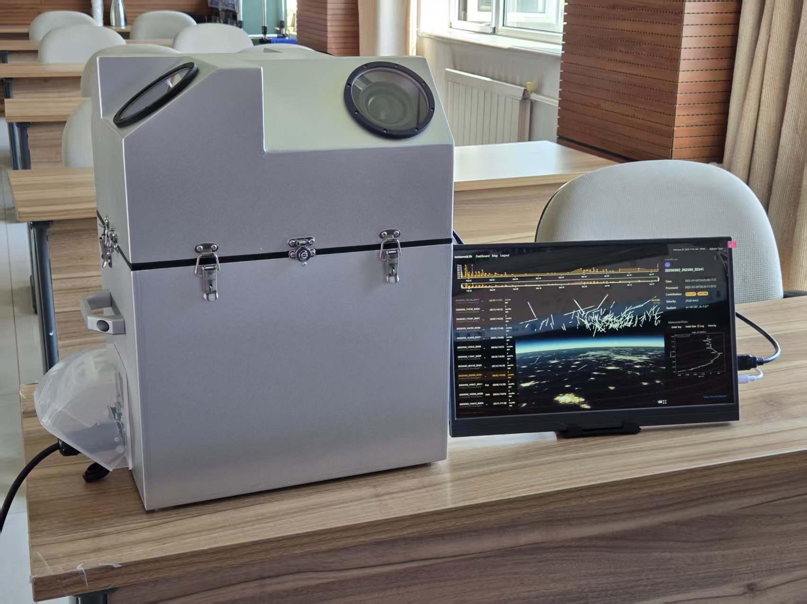
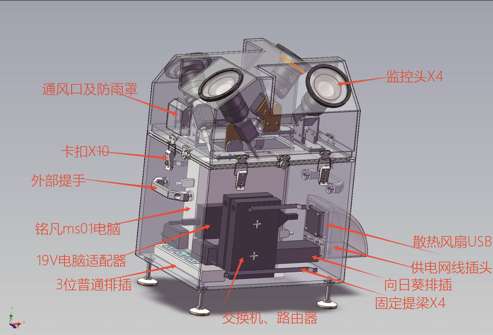
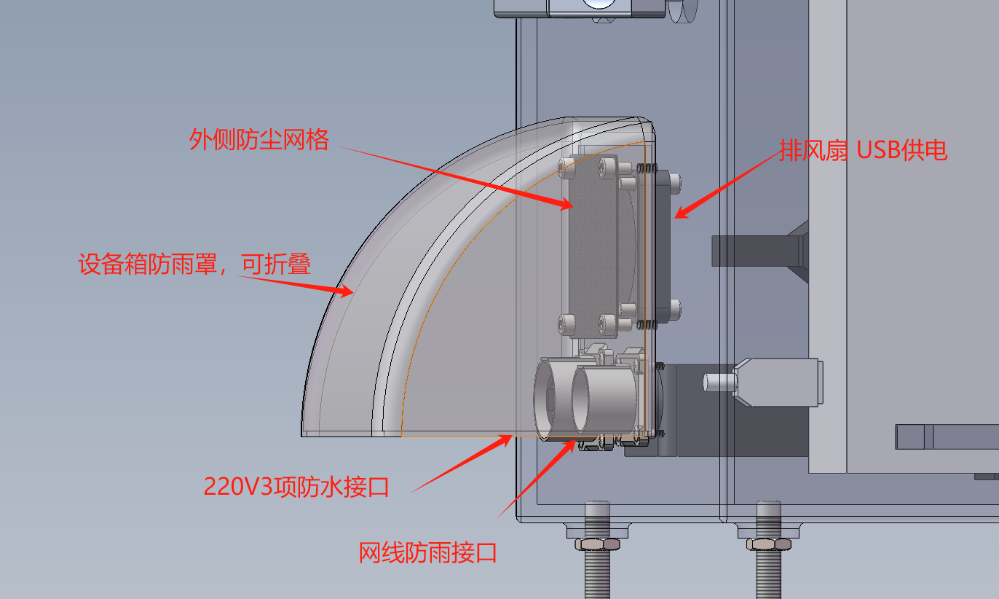

# 流星监测站硬件设备介绍

流星多站视频监测网（M³）的监测站自动完成观测、检测、测量和数据上传。我们提供初次安装、标定和运行技术支持，学校、科普基地及个人站长可通过网页管理设备、查看观测成果，开展科研协作与天文科普。设备无需每日照看，运行方可按需查看状态和结果。

网页操作见[数据平台使用方法](user-guide.md)。

## 认识监测站

*图1　流星监测站与平台展示画面。四方向观测单元和控制设备集成在户外机箱内。*

### 设备组成

监测站将四组天文相机与镜头、控制计算机、供电和网络组件集成在户外机箱内。相机面向不同天空区域连续拍摄；计算机自动识别目标并测量，随后向数据平台上传事件信息。GPS为图像提供精确时间信息，便于不同站点对同一事件开展联合分析。

*图2　监测站内部布局。上部布置四组光学观测单元，下部集成计算机、供电、网络和散热组件。*

| 部件 | 作用 | 运行方关注事项 |
| --- | --- | --- |
| 四组相机与8 mm F1.4镜头 | 采集不同朝向的天空图像 | 检查各路是否运行、图像是否清晰；调整镜头或朝向后需复核标定 |
| GPS授时单元 | 提供逐帧曝光时间 | 出现授时异常时记录状态并联系技术支持 |
| 观测窗与上部机箱 | 保护光学组件并提供观测通道 | 保持观测窗洁净，避免遮挡、结露和直射灯光 |
| 控制计算机 | 采集、检测、测量、缓存及上传 | 关注处理队列、剩余空间和运行日志 |
| 网络与供电组件 | 提供站端联网及设备电源 | 保证稳定220 V供电和无需登录的网络 |
| 密封、防雨和通风结构 | 支持户外运行及散热 | 检查卡扣、密封和通风口，避免积水及异物堵塞 |
| ADS-B接收模块和天线（选配） | 接收飞机广播信息，与光学记录关联 | 仅配备并配置该模块后使用 |

### 主要参数

| 项目 | 参数 |
| --- | --- |
| 相机数量 | 4台 |
| 单相机分辨率 | 1920 × 1200像素 |
| 快门与授时 | 全局快门，GPS逐帧授时 |
| 常用采集设置 | 30帧/秒、约33.3 ms曝光、8 bit工作模式 |
| 镜头 | 8 mm，F1.4 |
| 单相机视场 | 约77° × 51° |
| 计算机内存 | 16 GB |
| 存储容量 | >128 GB |
| 整机功耗 | 约50 W |
| 外部供电 | 220 V交流 |
| 主体尺寸 | 约332 × 260 × 489 mm |
| 整机重量 | 约17 kg |

极限星等、定轨精度及处理速度见[总体介绍和参数指标](overview.md)。事件数据的保存与上传按站点配置执行。

### 接口与初次启动

*图3　外部供电、网络接口及防雨罩。接线完成后，检查接口连接和防雨罩闭合情况。*

首次启动前，确认设备已可靠固定、观测窗无遮挡、外部线缆接好、机箱闭合，供电和网络条件已通过检查。通电后由技术人员核对相机识别、GPS状态、计算机运行、平台连接及站点坐标。

初次交付时，应记录站点编号、相机编号及朝向，领取平台账户和相应访问权限。站端认证密钥与个人登录账户用途不同，应分别妥善保管。不要在公开图片或群聊中展示密钥。

## 维护与交接

运行方负责台址、供电、网络及必要现场维护，我们提供软件、数据处理和平台技术支持。电费、网络费由运行方承担。设备无需每日照看，清洁和重新对焦按需进行，一般每年1—3次。因断电断网造成观测数据丢失的累计时长，每连续12个月不超过280小时（约28个观测夜晚）；数据完整保存且可补传的断网时段不计入。具体按[合作协议](cooperation.md)执行。

人员变更时应交接运行联系人、平台账户权限、设备编号、维护记录和未解决问题。设备搬迁或停用前联系我们，确认数据保存和设备处理方式。
