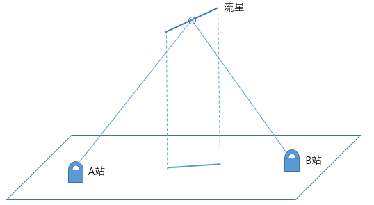
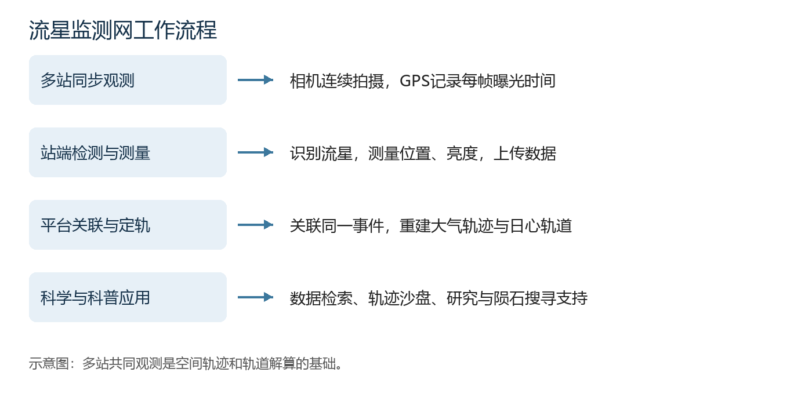

# 流星多站视频监测网总体介绍和参数指标

流星多站视频监测网（Multi-station Meteor Monitoring，简称M³）将分布于不同地点的流星监测站与统一数据平台连接起来，实现流星自动监测、快速定轨和观测数据共享。我们面向学校、科普基地及个人站长开展布站合作，共同积累科学观测数据，支持流星研究、陨石搜寻和天文科普。

## 工作原理与系统组成

流星体进入地球大气层后，与大气相互作用产生发光现象。不同地点的监测站连续拍摄天空，以恒星为参照测量流星的方向，并利用GPS时间戳关联各站记录。当两个或更多站点共同观测到同一颗流星时，平台根据不同视线的几何关系重建其大气空间轨迹，进一步计算速度、辐射点和进入大气前的日心轨道。

*图1　多站观测原理。A站和B站从不同位置记录同一颗流星，通过联合测量确定其空间轨迹。*

监测网由<strong>流星监测站</strong>和<strong>流星数据平台</strong>组成。站端负责图像采集、流星检测、位置与亮度测量及数据上传；平台负责站点管理、多站事件关联、轨迹与轨道计算、数据存储和可视化。

*图2　从多站同步观测到科学应用的数据处理流程。站端完成检测与测量，平台汇集各站数据开展联合定轨。*

### 流星监测站

监测站采用四相机集成结构，包含天文相机、广角镜头、GPS授时、控制计算机、网络与供电单元，以及带密封观测窗的户外机箱。四台相机面向不同天空区域，共同覆盖仰角20°以上的大部分天空。设备按照观测计划自动运行，检测到目标后保存事件数据并完成测量与上传。

*图3　流星监测站及数据平台展示。机箱上部为多方向观测单元，下部集成计算机、网络和供电组件。*

### 流星数据平台

数据平台将分散的站点接入统一监测网。运行方通过网页即可检查设备状态、配置相机、查看流星事件和多站定轨结果，并通过三维轨迹沙盘直观了解流星的运动过程。我们提供平台运营与技术支持，协助运行方开展长期观测、数据分析及科普活动。

## 主要功能

### 流星监测与快速定轨

- <strong>自动监测与事件保存：</strong>连续采集天空视频，自动检测流星，保存原始事件图像及逐帧时间信息。
- <strong>位置与亮度测量：</strong>利用恒星标定相机指向和光学畸变，测量流星的天球坐标与亮度变化。
- <strong>多站联合定轨：</strong>自动关联不同站点的同一事件，计算空间轨迹、速度、辐射点及日心轨道。
- <strong>潜在陨石事件分析：</strong>开展明亮火流星复核与落区分析，为陨石搜寻提供观测依据。

### 扩展观测与科普功能

| 功能 | 内容 |
| --- | --- |
| 人造天体监测 | 测量卫星、空间碎片等人造天体的坐标轨迹，生成带时间信息的坐标轨迹数据，支持定轨计算 |
| ADS-B飞机信息关联 | 通过选配的ADS-B接收设备和天线获取飞机广播信息，并与光学目标关联 |
| 实时流星AR直播 | 在天空画面叠加星图和目标标注，通过约1秒画面缓存，使流星提示先于流星在直播画面中出现 |
| 全景图生成 | 将完成天文标定的多相机图像投影、拼接，展示天空及流星分布 |

### 平台管理与数据服务

- 远程查看站点在线状态、相机运行状态、处理队列和计算机资源占用。
- 远程设置相机参数、观测计划、遮罩与标定参数，并执行相应控制操作。
- 在线浏览流星图片、视频及测量数据，查询多站事件和定轨结果。
- 使用流星轨迹沙盘查看三维轨迹、参与站点、速度、辐射点和轨道图。
- 按合作安排共享本站数据，并支持跨站数据申请和科研协作。

*图4　流星轨迹沙盘。时间分布曲线、多站事件列表、三维地图和事件详情联动展示，支持从整体流星活动浏览到单颗流星分析。*

## 基本参数

监测站采用单色天文CMOS相机、全局快门和GPS逐帧授时，四组广角镜头共同覆盖仰角20°以上的大部分天空。

| 项目 | 参数 |
| --- | --- |
| 单站相机数量 | 4台 |
| 单相机分辨率 | 1920 × 1200像素 |
| 观测帧率 | 30帧/秒 |
| 曝光时间 | 约33.3 ms |
| 采集位深 | 8 bit |
| GPS时间戳精度 | 约1 μs |
| 镜头焦距 | 8 mm |
| 最大光圈 | F1.4 |
| 单相机视场 | 约77° × 51° |
| 恒星极限星等 | 约5.58等 |
| 机箱主体平面尺寸 | 约332 × 260 mm |
| 总高度 | 约489 mm |
| 整机重量 | 约17 kg |
| 计算机内存 | 16 GB |
| 存储容量 | >128 GB |
| 整机功耗 | 约50 W |
| 外部供电 | 220 V交流 |

恒星极限星等采用8 mm镜头的堆叠图像测量，以50%的恒星信噪比大于3为判据。实际观测效果与天空背景、天气和光学状态有关。

## 定轨精度与处理速度

### 定轨精度

<strong>我们的定轨精度在同类视频流星监测设备中处于领先水平。</strong>在约77° × 51°的单相机视场下，轨迹角残差与GMN 16 mm相机的对比结果相当，辐射点和速度不确定度更优。

| 指标 | 数值 |
| --- | --- |
| 流星轨迹角残差中位数 | 0.142角分 |
| 辐射点不确定度中位数 | 0.082° |
| 速度相对不确定度中位数 | 0.123% |
| 空间轨迹定位精度 | 约10 m |

上述统计结果来自多站观测样本，辐射点和速度不确定度通过50次蒙特卡洛计算估计。定轨质量与共同观测站数、站间几何关系、流星亮度、时标和光学标定有关。

### 流星初次定轨时间

系统将站端检测测量与平台关联定轨连续衔接，快速生成流星初次定轨结果。

| 流星比例 | 获得初次定轨结果的时间 |
| --- | --- |
| 50% | 25秒内 |
| 95% | 40秒内 |

处理速度受CPU负荷、目标数量及处理队列影响。平台汇集同一事件的多站测量数据后开展定轨计算。

系统设计与定轨方法详见[流星多站视频监测网研究论文（PASP，2024）](https://doi.org/10.1088/1538-3873/ad8597)。

## 布站与合作

学校、科普基地和个人站长可通过部署监测站参与长期科学观测，并将实时天空画面、流星视频和轨迹沙盘用于课程、天文社团及公众活动。

运行方提供台址、供电、网络和必要维护，我们提供软硬件、平台运营及技术支持。台址条件详见[流星监测站布站要求](site-requirements.md)，成本承担与数据共享方式由[布站合作协议](cooperation.md)确定。
