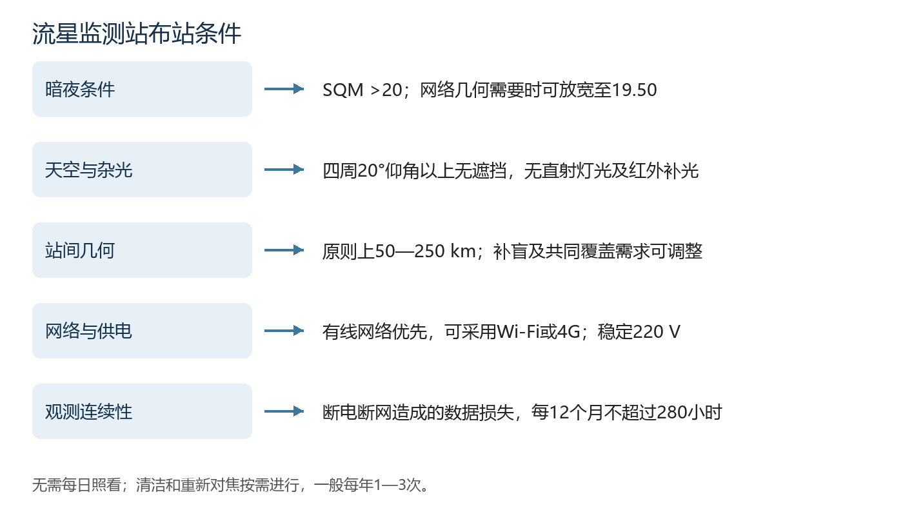
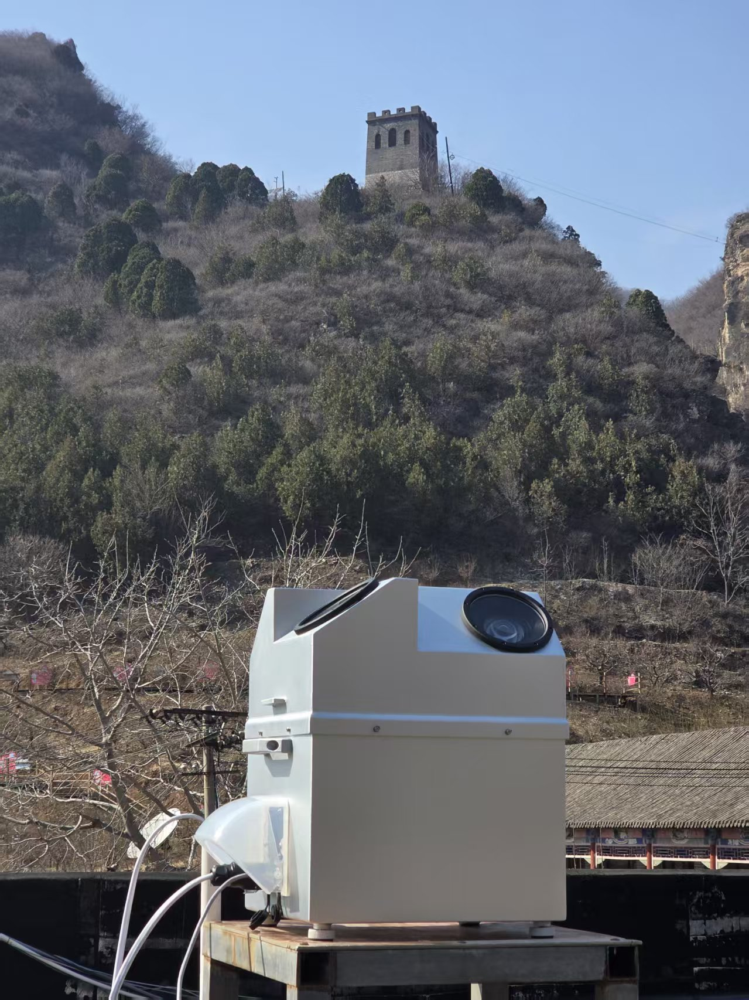
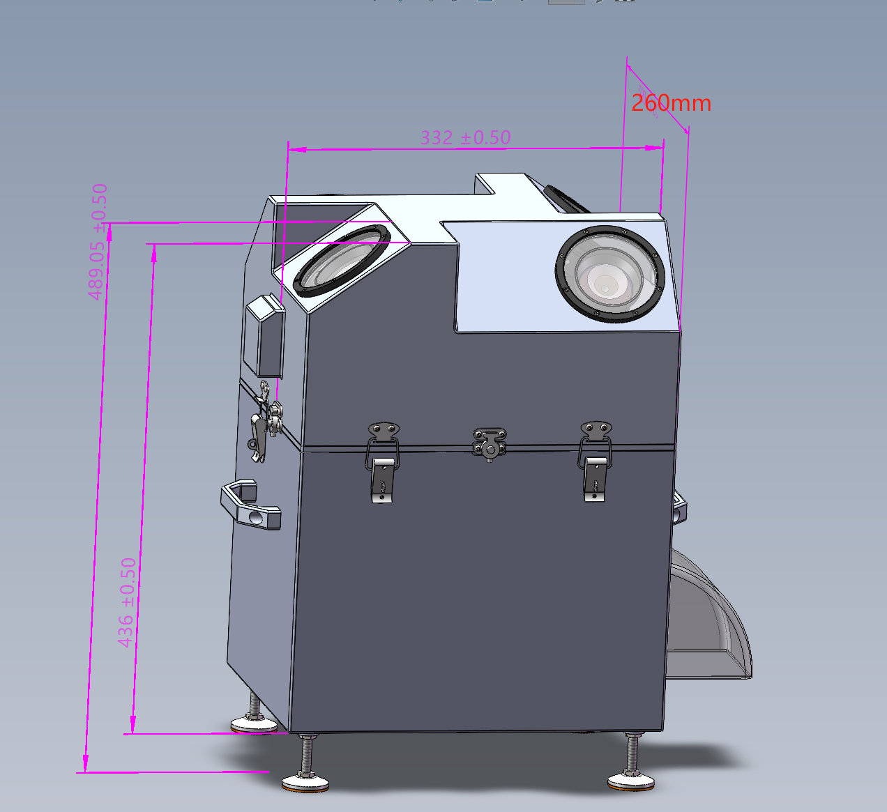

# 流星监测站布站要求

流星多站视频监测网（M³）面向学校、科普基地和个人站长开展布站合作。台址应具备良好的暗夜环境、开阔视野、稳定网络和供电条件，并与周边站点形成有效的联合观测布局。设备自动运行，无需每日照看，运行方主要负责场地保障和按需维护。

*图1　布站条件概览，涵盖暗夜环境、天空视野、站间几何、网络供电和观测连续性。*

## 暗夜环境与杂光

### 天空背景亮度

优先选择远离城市及强光源的地点。可使用[天文通光污染地图](https://www.darkmap.cn/)筛选候选台址，并记录经纬度和SQM值。SQM数值越大，表示天空越暗。

| 天空背景亮度 | 台址处理原则 |
| --- | --- |
| SQM >20.00 mag/arcsec² | 满足 |
| 19.50 ≤ SQM ≤20.00 mag/arcsec² | 在网络几何结构需要时可放宽至19.50 |
| SQM &lt;19.50 mag/arcsec² | 原则上不适宜 |

地图初筛后，应通过夜间现场检查核实局部灯光及天空背景。有条件时可使用天空亮度计测量，并记录时间、月相、云量和测量方向。

### 灯光与红外干扰

设备观测窗和相机视场应无灯光直射。现场检查应覆盖路灯、景观灯、楼体灯、感应灯及临时照明，确认夜间开灯后的实际影响。

观测区域应无监控红外补光干扰。检查时应让周边监控处于夜间工作状态，通过相机图像核查红外补光；存在干扰时，调整监控位置、关闭补光或更换安装点。

### 天气与晴夜条件

推荐选择气候干燥、临近沙漠或戈壁、晴夜数较多的位置，以获得更多有效观测时间。天气和晴夜条件作为台址优选因素，不设晴夜数量、空气湿度或与沙漠戈壁距离的具体要求，也不作为布站的硬性门槛。

## 天空视野与安装位置

### 视野要求

以设备安装后的实际观测位置为基准，<strong>四周各方向20°仰角以上应无遮挡</strong>。应检查建筑、女儿墙、树冠、电杆、天线和山体，并考虑树木生长及季节性枝叶变化。

候选台址应提供带方位信息的360°现场照片，记录主要障碍物的仰角。我们结合现场视野和共同观测范围确定相机指向及安装位置。

*图2　流星监测站户外安装实景。设备固定于稳定平台上，观测窗面向周围天空。*

### 安装基础与维护空间

安装基础应稳定，能够可靠固定设备，避免振动、沉降或倾倒。整机约17 kg，主体平面尺寸约332 × 260 mm，总高约489 mm。安装时应为侧向附件、线缆和开盖维护留出空间。

安装点应排水良好，便于安全到达和检修。屋顶或高台安装由场地管理方确认承载、固定方式、防水和维护通道；供电、接地与防雷措施结合现场条件实施。

*图3　监测站外形尺寸及支脚位置，尺寸单位为mm。基础设计同时考虑侧向附件和维护空间。*

## 站网几何要求

为形成有效的多站共同观测，新站与参与联合观测的周边站点之间，<strong>距离原则上不小于50 km、不大于250 km</strong>。台址选择应同时考虑站间距离、相机视野及共同覆盖区域。

以下情况可采用小于50 km的站间距离：

- 周边站点因视野遮挡等原因存在观测盲区，需要增设站点补盲。
- 存在大块仅由单站覆盖的区域，急需增加多站共同覆盖。

采用非标准相机或镜头配置的站点，根据其视场、灵敏度和测量特性单独评估站间布局。我们在台址评估阶段结合现有站网确定布站方案。

## 网络要求

优先提供<strong>无需网页登录、扫码认证或周期性人工登录的有线网络</strong>，确保设备重启或恢复供电后能够自动联网。

有线接入困难时，可采用稳定的<strong>Wi-Fi或4G网络</strong>。无线网络应在实际安装位置测试信号稳定性、自动重连及数据上传能力；Wi-Fi应支持持续连接，4G应配置满足观测上传需求的流量套餐。

交付前应完成平台状态上报、流星测量报告以及图片和视频上传测试，确认远程控制与数据传输正常。

## 供电与运行连续性

运行方须提供<strong>220 V稳定交流供电</strong>，使用能够持续供电的线路，保证观测时段正常运行。户外线路、插座和接线应具备相应保护措施。

<strong>每连续12个月，因断电、断网造成观测数据丢失的累计时长不得超过280小时，约等于28个观测夜晚。</strong>从站点实际投入运行日开始统计，按实际损失小时数累计；断电与断网重叠的时段只计算一次。

断网期间，本地数据完整保存且恢复后能够补传的时段不计入损失。天气原因另行记录。运行方应记录数据损失的起止时间、原因及恢复情况，电费和网络费由运行方承担。

可结合场地条件配置后备供电和网络恢复措施，提高连续观测能力。

## 运行方维护职责

<strong>设备无需每日照看。清洁和重新对焦按需进行，一般每年1—3次。</strong>我们提供远程技术支持，协助判断图像质量变化和维护需求。

运行方指定一名联系人及替补联系人，负责通报停电、断网、施工、新增灯光和遮挡，配合必要的现场检查与维护。检查内容包括观测窗洁净度、固定件、外部线缆、通风和防雨结构；大风、雷雨或施工后，可根据实际情况增加检查。

清洁、开盖或重新对焦按技术指导操作。调整镜头或相机朝向后，应重新核查标定和天空覆盖。

## 布站实施与验收

1. <strong>提交候选地点。</strong>提供位置、场地使用条件、联系人和拟运行期限。
2. <strong>完成环境初筛。</strong>提交SQM查询记录、带方位信息的现场照片及遮挡情况。
3. <strong>评估站网几何。</strong>核查周边站点距离、共同视场和补盲需求，确定布站方案。
4. <strong>开展夜间核查。</strong>检查直射灯光、监控红外补光和实际天空背景。
5. <strong>测试网络与供电。</strong>确认自动联网、平台通信、数据上传及恢复供电后的运行情况。
6. <strong>安装与配置。</strong>固定设备、完成接线，记录位置和相机朝向，完成标定及观测计划设置。
7. <strong>试运行与交接。</strong>检查各相机图像、GPS状态、上传和平台结果，完成操作培训与交接记录。

### 台址验收记录表

| 检查项目 | 填写内容 | 结果 |
| --- | --- | --- |
| 站点名称及编号 | ______ | ______ |
| 经纬度与海拔 | 坐标基准、获取方式：______ | ______ |
| 场地使用条件 | 场地管理方及使用期限：______ | ______ |
| 天空背景亮度 | SQM：______；地图/实测；日期：______ | ______ |
| 四周视野 | 20°以上遮挡情况及照片：______ | ______ |
| 灯光与红外 | 夜间检查及整改情况：______ | ______ |
| 站网几何 | 周边站点、距离、共同覆盖或补盲需求：______ | ______ |
| 安装基础 | 固定、承载、排水、维护通道：______ | ______ |
| 网络条件 | 有线/Wi-Fi/4G；自动联网及上传测试：______ | ______ |
| 供电条件 | 220 V；连续供电及保护措施：______ | ______ |
| 中断记录 | 按数据损失小时数累计：______ | ______ |
| 试运行 | 起止日期、相机状态、上传结果：______ | ______ |
| 联系人与交接 | 建设方：______；运行方：______ | ______ |

本文件与[布站合作协议](cooperation.md)及[设备与平台使用方法](user-guide.md)配套使用。
