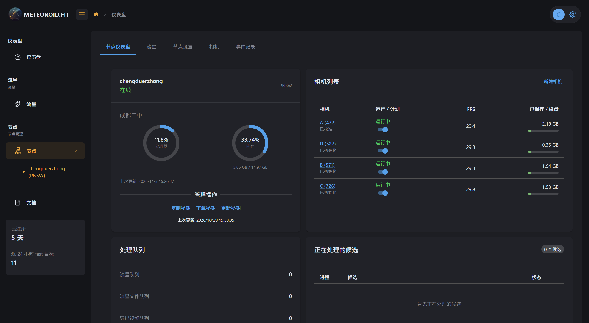
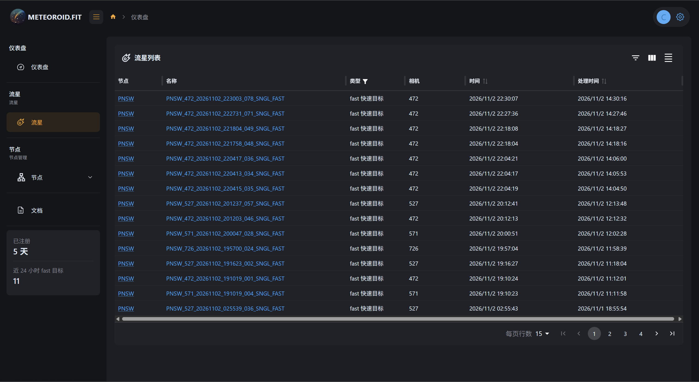
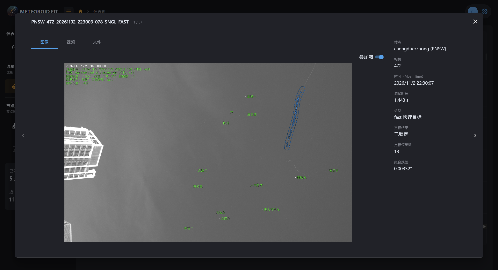
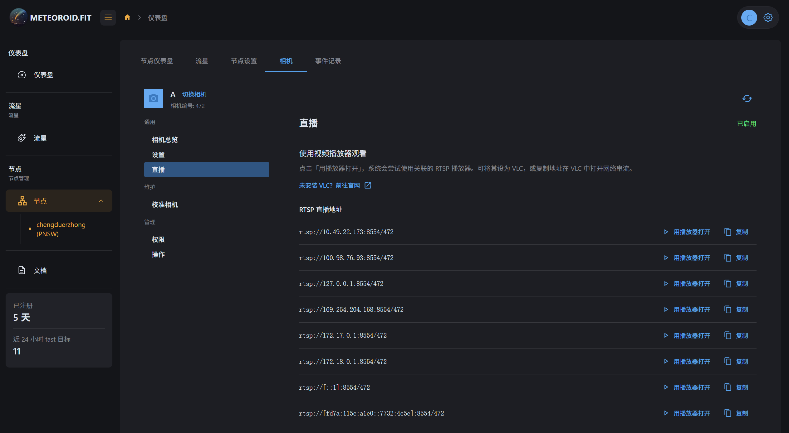
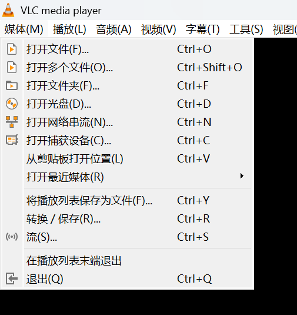
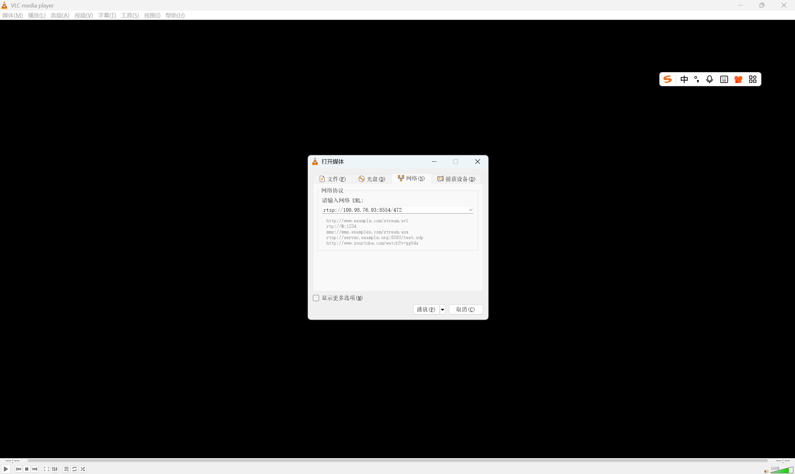
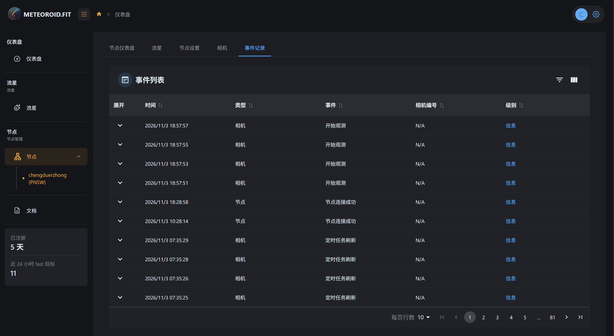
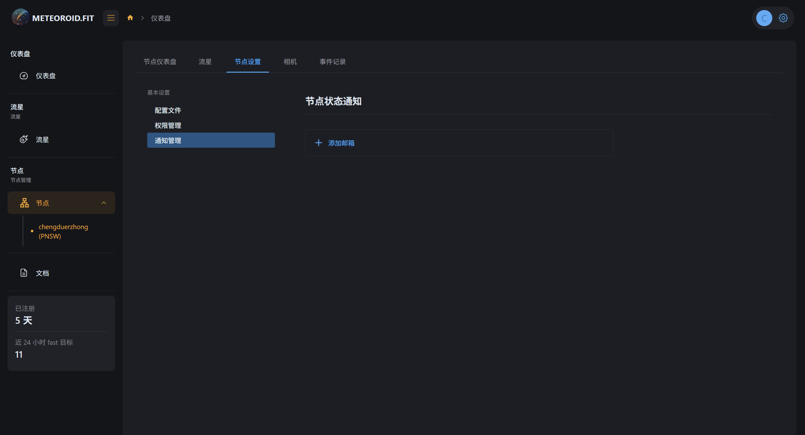

# 数据平台使用方法

平台网址 [https://m3.dev.meteoroid.fit/](https://m3.dev.meteoroid.fit/)。

本说明介绍日常查看节点状态、浏览流星、观看直播和管理节点的方法。登录后，从左侧菜单进入相应页面；若菜单收起，可点击左上角菜单按钮展开。

配图来自实际操作界面，图中的节点名称、相机编号、时间、统计数值和网络地址均为示例，请以自己页面显示的内容为准。部分管理功能需要相应权限；看不到入口或无法操作时，请联系管理员。

## 1. 查看节点状态

### 进入节点仪表盘

1. 在左侧菜单展开 **节点**。
2. 点击需要查看的节点名称。
3. 打开顶部的 **节点仪表盘** 标签页。

首页 **仪表盘** 可以查看节点概况和流星统计；查看某个节点的详细运行情况时，使用下图所示的 **节点仪表盘**。

### 重点查看哪些信息

日常主要确认节点是否在线、上次更新时间是否正常，以及相机是否正在运行；也可留意帧率、处理器、内存和磁盘占用。处理队列为 0 或没有正在处理的候选，通常表示当前没有待处理任务。

**节点在线**表示节点与平台保持连接，相机是否拍摄需查看其运行状态。相机按预设计划启停，非观测时段未运行不一定是故障。“运行 / 计划”下方的开关用于启停观测计划，日常查看时无需切换。

若节点持续离线、更新时间长时间不变，或观测时段相机持续未运行，可先查看 [事件记录](#_4-2-查看运行事件)，并将节点名称、相机编号和异常时间提供给维护人员。

## 2. 查看拍摄到的流星

### 打开流星列表

点击左侧菜单 **流星**，可浏览当前账号可见的流星记录。若只想查看某个节点的数据，可进入该节点，再点击顶部 **流星** 标签页。

列表中可以查看节点、名称、类型、相机、时间和处理时间。使用底部页码翻页，或调整每页行数；需要筛选时，可点击右上角筛选按钮，按页面提供的条件查找。列表默认筛选 **fast 快速目标**，查找其他类型时请调整类型筛选。

点击一条记录的 **名称**，打开详情窗口。窗口左右两侧的箭头可切换上一条、下一条记录，右上角 **×** 可关闭窗口。

### 查看图像与视频

- **图像**：查看流星图像。有叠加数据时，可通过 **叠加图** 开关显示或隐藏轨迹、星名等标注。
- **视频**：切换到该标签后，点击播放器的播放按钮观看，并使用播放器控件暂停、拖动进度或全屏查看。
- **右侧信息**：查看站点、相机、时间、流星时长、类型和定标结果等信息。

图像与视频是否可用取决于该记录已有的文件。若提示暂无图像、暂无视频或加载失败，可稍后重新打开；持续无法查看时，请记录流星名称并联系维护人员。

### 保存图像、视频和其他文件

可以采用以下两种方式：

1. **右键保存**：在图像上点击鼠标右键，选择浏览器的“图片另存为”；在视频上点击右键，若浏览器提供“视频另存为”，可直接保存。右键保存的图片通常是底图，页面上的叠加标注不一定包含在内。
2. **在“文件”中下载**：切换到详情窗口的 **文件** 标签页，找到需要的图像、视频或其他文件，点击该行的 **下载**。该页也可下载记录的 JSON 数据；文件显示不可用时，暂时无法下载。

如果希望保存叠加标注文件，请在 **文件** 中选择相应文件下载。若下载按钮打开了新的图像或视频页面，可在新页面中使用浏览器的保存功能。

## 3. 在内网观看直播

直播通过 RTSP 地址在 VLC 等视频播放器中观看。请先让播放设备接入与节点相通的内网；能够打开网站，并不代表设备一定可以访问节点的直播地址。

### 获取 RTSP 地址

1. 在左侧 **节点** 中选择目标节点。
2. 打开顶部 **相机** 标签页，确认当前相机；需要时点击 **切换相机**。
3. 点击相机页面左侧的 **直播**。
4. 页面显示直播已启用并列出 **RTSP 直播地址** 后，选择合适的地址，点击 **复制**。

**优先尝试节点所在内网可达的私有地址**，常见形式如下：

| 地址范围 | 示例形式 |
| --- | --- |
| `10.0.0.0`～`10.255.255.255` | `rtsp://10.x.x.x:端口/相机编号` |
| `172.16.0.0`～`172.31.255.255` | `rtsp://172.16.x.x:端口/相机编号` |
| `192.168.0.0`～`192.168.255.255` | `rtsp://192.168.x.x:端口/相机编号` |

复制页面提供的完整链接，保留其中的端口和相机编号。并非所有以 `172` 或 `192` 开头的地址都是私有地址；同一节点也可能列出多个网卡地址，只有播放设备能够访问的地址才能使用。部分 `172.17`、`172.18` 等地址可能属于容器网络，即使是私有地址，也不一定能从你的电脑访问。

`127.0.0.1` 和 `::1` 表示播放设备自身，在另一台电脑上观看时通常不能使用。截图中的 `100.x` 地址可能依赖专用组网环境，请按维护人员提供的网络条件使用。

### 用 VLC 打开网络串流

以下以 Windows 版 VLC 为例：

1. 打开 VLC。未安装时，可使用直播页面提供的 VLC 官网入口下载安装。
2. 在 VLC 菜单选择 **媒体 → 打开网络串流**，或按 **Ctrl + N**。

   

3. 在“网络”标签页的 **请输入网络 URL** 输入框中，粘贴刚刚复制的完整 RTSP 地址。
4. 点击 **播放**，等待画面出现。

   

图中的地址仅演示填写位置，请替换为自己直播页面中可达的内网地址。

也可以直接点击直播地址右侧的 **用播放器打开**，系统会尝试调用已关联的播放器。如果没有反应，可按上述步骤手动粘贴地址。其他系统上的菜单名称可能略有不同，选择打开网络地址或网络串流的功能即可。

### 无法观看时

- **页面提示直播未启用、相机未运行或正在等待地址**：按页面提示确认节点和相机状态，需要调整设置时联系维护人员。
- **VLC 无法连接**：确认设备已接入节点所在内网，尝试页面列出的其他可达私有地址，并检查是否复制了完整链接。
- **多个地址都无法连接**：将节点名称、相机编号、尝试的地址及报错信息提供给维护人员，协助检查网络连通性和直播服务。

## 4. 节点管理

节点在安装、配置和调试完成后，通常会按计划自动运行，日常基本不需要额外操作。用户主要查看状态、流星记录和运行事件，并按需维护通知邮箱。

### 4.1 节点设置与配置文件

入口：**节点 → 选择节点 → 节点设置**。页面包含 **配置文件、权限管理、通知管理** 等项目。

**节点配置文件需要由了解设备和系统的专业人员修改，请勿贸然编辑或点击“同步”。** 配置变更可能影响相机连接、观测计划和数据处理。需要调整参数时，请先联系维护人员确认。

相机设置、校准、管理操作、节点密钥更新及权限调整，也应在明确用途后由相应人员处理。

### 4.2 查看运行事件

入口：**节点 → 选择节点 → 事件记录**。

事件列表记录节点和相机的运行情况，例如节点连接成功、开始观测和定时任务刷新。可以查看事件发生的 **时间、类型、事件名称、相机编号和级别**；点击每行左侧的展开箭头，可查看详细内容。

按需使用筛选、排序和底部分页查找记录。普通“信息”事件可帮助了解运行过程；出现“警告”或“错误”，或同类异常反复出现时，可结合节点仪表盘判断，并将事件详情反馈给维护人员。

### 4.3 添加通知邮箱

入口：**节点 → 选择节点 → 节点设置 → 通知管理**。

1. 点击 **添加邮箱**。
2. 输入联系人可正常收信的邮箱地址。
3. 点击 **保存**，等待保存成功提示。
4. 如需通知多位联系人，可继续添加其他邮箱并保存。

添加成功后，系统可按节点通知规则，将重要状态通知发送到这些邮箱。请留意收件箱和垃圾邮件文件夹；并非每条运行事件都会发送邮件，完整运行记录请在 **事件记录** 中查看。

联系人变更时，可删除不再使用的邮箱，并添加、保存新的邮箱。若提示保存失败，请确认邮箱填写正确并重试，仍无法保存时联系管理员。
