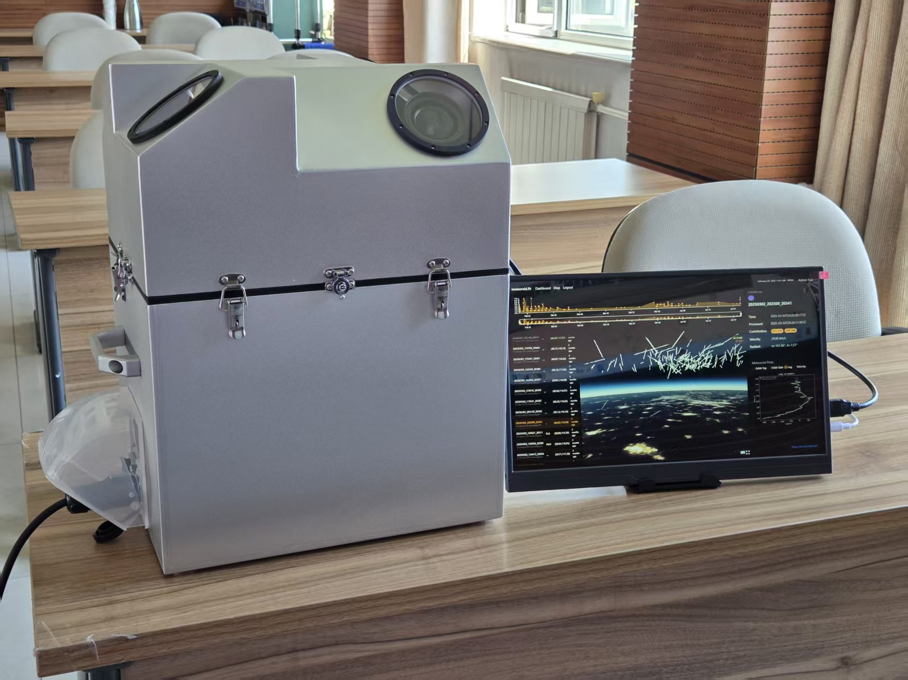
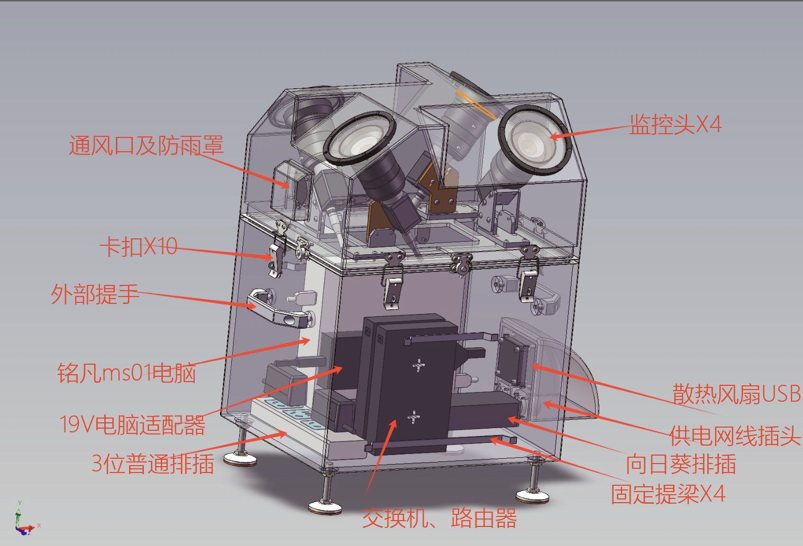
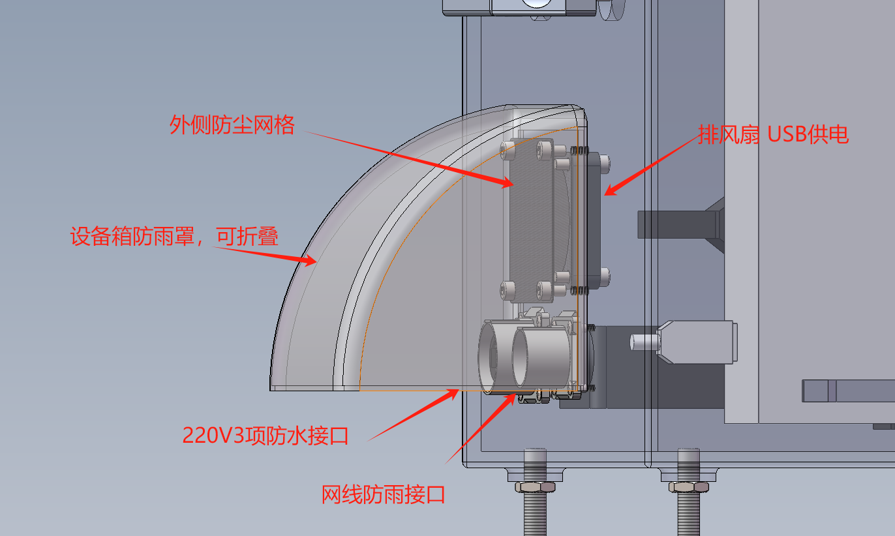
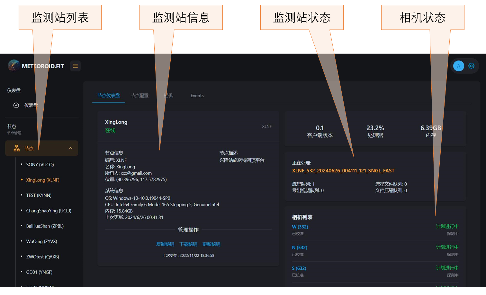
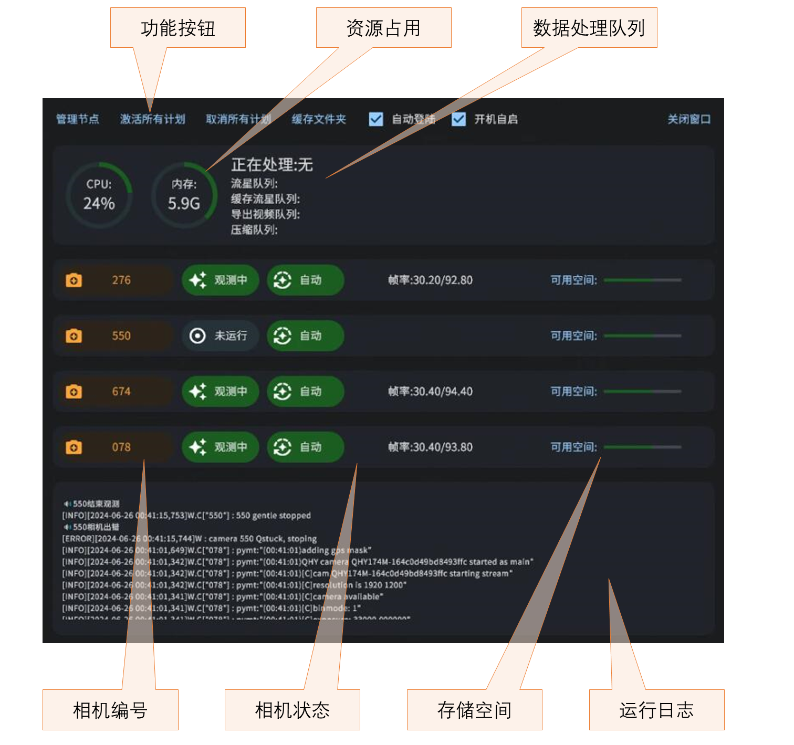
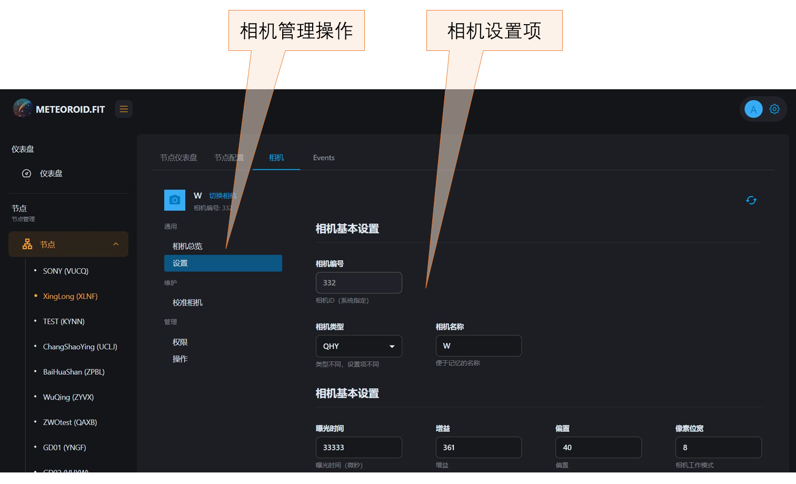
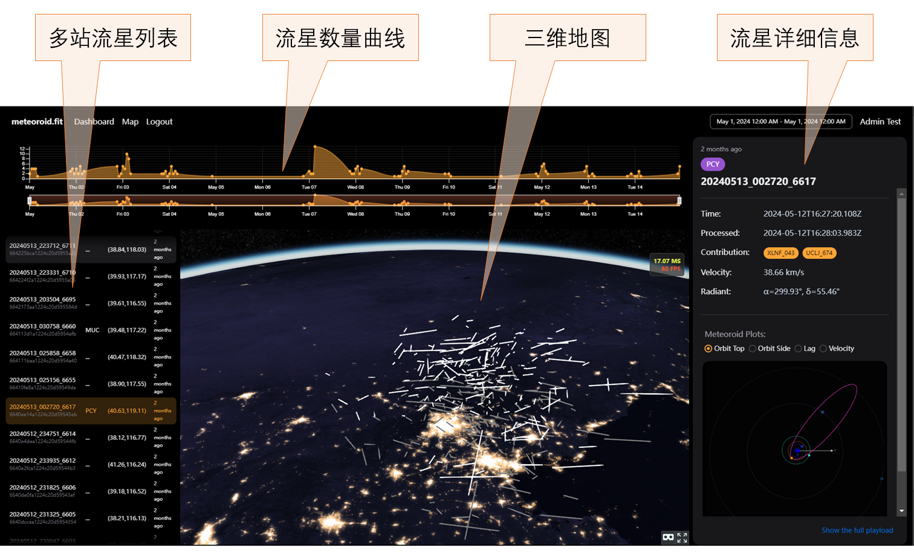

# 流星监测站硬件与平台使用指南

流星多站视频监测网（M³）的监测站自动完成观测、检测、测量和数据上传。我们提供初次安装、标定和运行技术支持，学校、科普基地及个人站长可通过网页管理设备、查看观测成果，开展科研协作与天文科普。设备无需每日照看，运行方可按需查看状态和结果。

平台访问地址随账户开通提供。

## 认识监测站

*图1　流星监测站与平台展示画面。四方向观测单元和控制设备集成在户外机箱内。*

### 设备组成

监测站将四组天文相机与镜头、控制计算机、供电和网络组件集成在户外机箱内。相机面向不同天空区域连续拍摄；计算机自动识别目标并测量，随后向数据平台上传事件信息。GPS为图像提供精确时间信息，便于不同站点对同一事件开展联合分析。

*图2　监测站内部布局。上部布置四组光学观测单元，下部集成计算机、供电、网络和散热组件。*

| 部件 | 作用 | 运行方关注事项 |
| --- | --- | --- |
| 四组相机与8 mm F1.4镜头 | 采集不同朝向的天空图像 | 检查各路是否运行、图像是否清晰；调整镜头或朝向后需复核标定 |
| GPS授时单元 | 提供逐帧曝光时间 | 出现授时异常时记录状态并联系技术支持 |
| 观测窗与上部机箱 | 保护光学组件并提供观测通道 | 保持观测窗洁净，避免遮挡、结露和直射灯光 |
| 控制计算机 | 采集、检测、测量、缓存及上传 | 关注处理队列、剩余空间和运行日志 |
| 网络与供电组件 | 提供站端联网及设备电源 | 保证稳定220 V供电和无需登录的网络 |
| 密封、防雨和通风结构 | 支持户外运行及散热 | 检查卡扣、密封和通风口，避免积水及异物堵塞 |
| ADS-B接收模块和天线（选配） | 接收飞机广播信息，与光学记录关联 | 仅配备并配置该模块后使用 |

### 主要参数

| 项目 | 参数 |
| --- | --- |
| 相机数量 | 4台 |
| 单相机分辨率 | 1920 × 1200像素 |
| 快门与授时 | 全局快门，GPS逐帧授时 |
| 常用采集设置 | 30帧/秒、约33.3 ms曝光、8 bit工作模式 |
| 镜头 | 8 mm，F1.4 |
| 单相机视场 | 约77° × 51° |
| 计算机内存 | 16 GB |
| 存储容量 | >128 GB |
| 整机功耗 | 约50 W |
| 外部供电 | 220 V交流 |
| 主体尺寸 | 约332 × 260 × 489 mm |
| 整机重量 | 约17 kg |

极限星等、定轨精度及处理速度见[总体介绍和参数指标](overview.md)。事件数据的保存与上传按站点配置执行。

### 接口与初次启动

*图3　外部供电、网络接口及防雨罩。接线完成后，检查接口连接和防雨罩闭合情况。*

首次启动前，确认设备已可靠固定、观测窗无遮挡、外部线缆接好、机箱闭合，供电和网络条件已通过检查。通电后由技术人员核对相机识别、GPS状态、计算机运行、平台连接及站点坐标。

初次交付时，应记录站点编号、相机编号及朝向，领取平台账户和相应访问权限。站端认证密钥与个人登录账户用途不同，应分别妥善保管。不要在公开图片或群聊中展示密钥。

## 按需查看运行状态

在查看观测成果、接到异常通知或完成现场维护后，可按以下顺序检查：

1. 打开我们提供的平台地址，登录账户，在“节点”列表中选择自己的监测站。
2. 查看“节点仪表盘”：站点是否在线、状态是否更新，各相机是否按计划工作。
3. 查看处理队列、CPU和内存占用，确认存储空间没有持续逼近耗尽。
4. 在观测时段抽查图像，确认画面没有新增遮挡、强光、失焦或明显结露。
5. 查看近期事件及上传情况。没有流星记录时，结合云量、天气和运行时间检查。

白天设备按观测计划待机，夜间按计划启动。检查时分别查看节点连接状态和各路相机状态。

## 查看站点和本地运行状态

### 网页节点仪表盘

*图4　站点管理页面。左侧选择节点，中部查看节点信息，右侧查看资源、处理队列及相机状态。*

操作路径：<strong>节点 → 选择站点 → 节点仪表盘</strong>。

- <strong>站点信息：</strong>核对站点编号、名称和位置，防止在多个站点之间误操作。
- <strong>资源状态：</strong>查看处理器、内存及正在处理的事件。资源占用较高时，结合队列是否持续增长判断。
- <strong>相机列表：</strong>逐台检查相机状态及计划状态。发现某一路长期异常时，记录相机编号。
- <strong>认证管理：</strong>复制、下载或更新密钥属于管理员操作；不作为日常巡检步骤。

### 本地客户端

*图5　本地客户端运行界面。上方显示计划控制和资源占用，中部显示各相机状态及存储空间，下方显示运行日志。*

在设备现场或按授权远程连接计算机后，可用客户端辅助检查。图中“激活所有计划”“取消所有计划”会影响观测安排，使用前应确认当前任务。日常应保持交付时确定的自动运行和开机启动设置。

队列短时增加可能是正常处理过程；队列持续增加且很久不下降，或某路相机长时间未运行，应联系技术支持。除非已确认缓存数据完成上传和备份，不要直接清空缓存文件夹。

## 配置相机与恢复观测

### 查看相机参数

*图6　相机设置页面，可查看和配置曝光时间、增益、偏置及采集位深。*

操作路径：<strong>节点 → 选择站点 → 相机 → 切换相机 → 设置</strong>。

先核对相机名称和编号，再查看曝光时间、增益、偏置、像素位宽等参数。图中曝光时间单位为微秒：33,333 μs约等于33.3 ms。曝光、增益和偏置采用交付时完成测试的配置，调整时由技术支持协助。

修改前记录原配置。按照页面实际提供的保存或应用方式提交后，应检查日志或状态反馈，确认配置已到达站端；随后检查新图像和采集状态。

### 初始配置与标定流程

初始配置与标定由技术人员指导，按以下顺序完成：

1. <strong>选择相机及基础采集设置。</strong>检查图像能否正常返回。
2. <strong>获取测试图像并设置遮罩。</strong>排除图像中的非天空区域。
3. <strong>评估图像质量。</strong>检查稳定性、噪声和恒星像宽，确认焦点和检测参数合适。
4. <strong>开展天文标定。</strong>在能够辨认恒星的天气条件下，求解相机指向及畸变模型。
5. <strong>恢复或启用观测计划。</strong>检查各相机按计划运行，确认事件信息能够上传。

相机方向、位置、镜头或焦点发生变化后，应复核标定。远程启停通过“操作”或观测计划管理区执行，相关权限由管理员配置。

## 查看流星数据

### 单站事件

进入已授权站点的数据或事件列表，选择日期范围和事件，查看对应图片、视频及测量信息。

查看时先确认站点、相机编号和事件时间，再判断目标形态。事件列表包含流星及其他运动目标记录；多站流星的轨迹和轨道可在轨迹沙盘中进一步查看。

| 数据形式 | 用途 |
| --- | --- |
| PNG图片 | 快速查看轨迹、恒星标注和图像质量 |
| MP4视频 | 回放运动过程、进行科普展示 |
| JSON测量信息 | 保存事件信息、时间及坐标等结构化结果 |
| FITS原始事件数据 | 用于进一步科学分析，可包含原始图像、逐帧时标及测量信息 |

数据保存、上传及获取方式按站点配置和[合作协议](cooperation.md)执行。科普回放可使用MP4视频，进一步科学分析可使用FITS原始数据和JSON测量信息。

### 时间与处理状态

事件发生时间和处理完成时间是两个不同字段。页面中带“Z”的时间字符串表示UTC；转换为北京时间时加8小时，并注意可能跨日。查看其他时间字段时，留意页面标注的时区。

检测、测量、上传、多站关联和轨道计算是连续但不同的环节。站端上传事件后，平台汇集其他站点的共同观测数据，再开展关联与定轨。

## 使用流星轨迹沙盘

*图7　流星轨迹沙盘。上方为数量和时间分布，左侧为多站事件列表，中间为三维地图，右侧为所选事件详情。*

1. 在平台中打开三维地图或轨迹展示页面，按所需观测日期选择时间范围。
2. 从左侧多站事件列表选择一颗流星，结合地图观察其大气轨迹。
3. 在右侧核对事件编号、发生时间、处理时间及“Contribution”所列的观测贡献标识。
4. 阅读“Velocity”速度和“Radiant”辐射点信息。辐射点表示流星在天球上的来向，以赤经α、赤纬δ描述。
5. 按需要切换“Orbit Top”“Orbit Side”“Lag”“Velocity”等图表，查看轨道俯视、侧视或运动拟合信息。

三维轨迹展示流星在大气中发光阶段的空间路径，轨道图展示流星体进入大气前绕太阳运行的轨道。两种视图适合结合使用，帮助学生和公众理解流星的来向及运动过程。

## 科普与扩展功能

### 实时流星AR直播

AR直播在天空画面上叠加星图和流星提示。准备活动时，先确认站点在线、相机指向及标定有效、图像清晰，再通过直播入口进行测试，核查画面标注和流畅度后用于活动。

通过约1秒画面缓存，流星提示先于流星在直播画面中出现，帮助观众及时关注目标区域。星图与名称标注可配合流星雨直播、观星课程和公众讲解。

### 全景图生成

全景图功能将经过天文标定的多相机图像按统一天空坐标展示。使用前检查各相机图像和标定，生成后检查接缝、恒星位置及画面时间信息，再用于天空展示或流星活动介绍。

### ADS-B飞机信息关联

ADS-B为选配功能，需安装接收模块和天线并完成软件配置。启用后可将接收到的飞机位置广播与相机中的相应目标关联，辅助区分飞机和其他移动目标。

## 常见问题与处理

| 现象 | 优先检查 | 建议处理 |
| --- | --- | --- |
| 节点离线 | 现场供电、路由器、网线、是否需要重新登录网络 | 记录开始时间，恢复基础连接；仍异常时联系技术支持 |
| 节点在线但某路相机未运行 | 是否处于观测时段、计划是否启用、相机日志 | 记录相机编号与日志，按指导恢复，不反复盲目重启 |
| 夜间没有流星事件 | 云量、背景亮度、各路画面及计划状态 | 先排除天气与计划因素，再检查检测和上传流程 |
| 画面模糊或出现强光 | 观测窗结露、积灰、失焦、附近灯光或红外补光 | 按指导检查和清洁，光学位置改变后复核标定 |
| 处理队列长期积压 | CPU占用、事件数量、磁盘空间、上传状态 | 保留日志与缓存，联系技术支持调整处理策略 |
| 本地有事件但平台暂未显示 | 网络、上传队列、平台时间范围和访问权限 | 检查上传状态与筛选范围，避免重复删除或搬移原始文件 |
| 事件有图像但无轨道 | 是否有其他站点共同观测、关联及质量条件 | 等待或请求技术复核；单站事件不一定能定轨 |
| 时间相差8小时 | UTC与北京时间显示差异 | 先检查时区标记，再判断是否为授时故障 |

求助时建议提供站点编号、相机编号、异常开始时间及其时区、截图、近期改动和相关日志片段。避免发送账号密码或认证密钥。

## 维护与交接

运行方负责台址、供电、网络及必要现场维护，我们提供软件、数据处理和平台技术支持。电费、网络费由运行方承担。设备无需每日照看，清洁和重新对焦按需进行，一般每年1—3次。因断电断网造成观测数据丢失的累计时长，每连续12个月不超过280小时（约28个观测夜晚）；数据完整保存且可补传的断网时段不计入。具体按[合作协议](cooperation.md)执行。

人员变更时应交接运行联系人、平台账户权限、设备编号、维护记录和未解决问题。设备搬迁或停用前联系我们，确认数据保存和设备处理方式。
